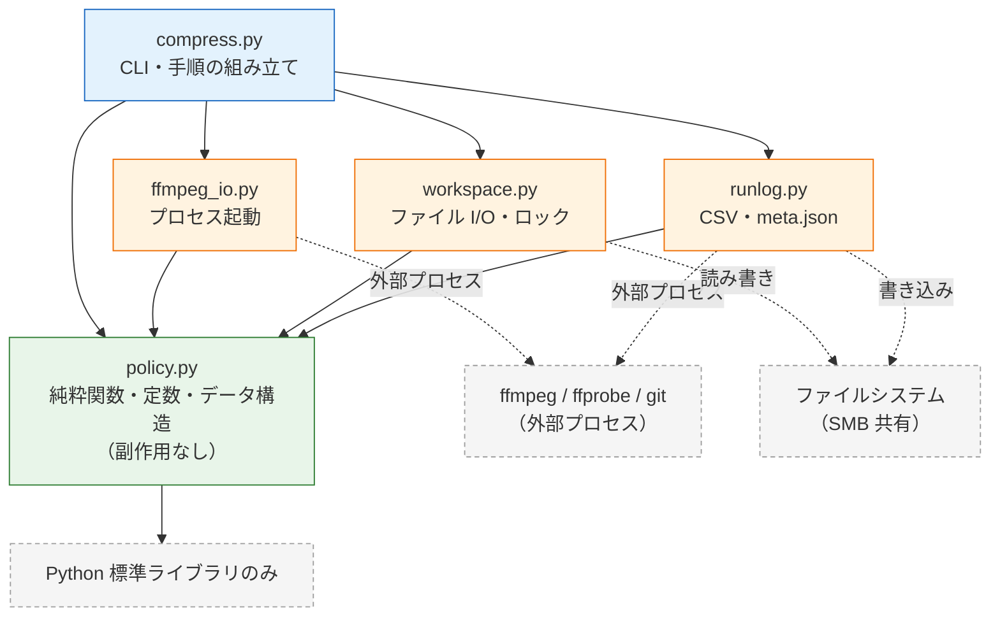
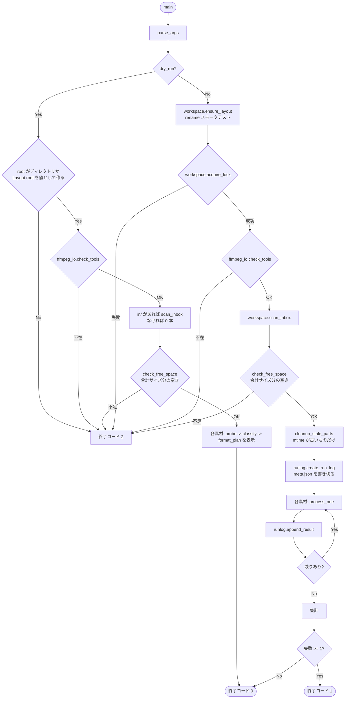
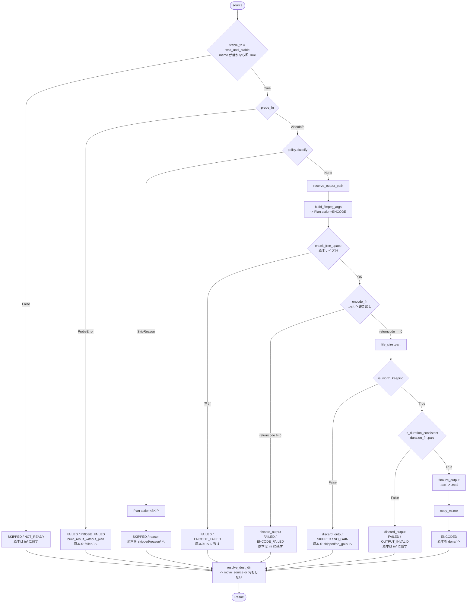

# 動画ファイル一括圧縮ツール 設計書

- 版数: 0.3
- 作成日: 2026-08-31
- 更新日: 2026-11-10
- 前版: design.md v0.2（その前は detailed_design.md v0.1）
- 対象要件: 要件定義書 v1.1
- 本書の範囲: 方式選定、モジュール構成、公開インターフェース、データフロー、実装順序。実装コードは含まない

v0.1 に対するレビューで指摘された 7 件の重大な設計欠陥（後述）を反映した改訂版です。
v0.1 からの変更点は各節の末尾に「**v0.1 からの変更**」として記載します。

v0.3 は、v0.2 の実装中に見つかった不整合を合意のうえ反映したものです。
v0.2 からの変更点は「**v0.2 からの変更**」として記載し、一覧を末尾の「付録 2」に置きます。

---

## 採用した方式と、他案を採らなかった理由

### 方式A: plan / apply 分離（採用）

1 素材の処理を「何をするかを決める（plan）」と「決めたことを実行する（apply）」の 2 段に分けます。
plan の生成は純粋関数（`policy.classify()` / `policy.build_ffmpeg_args()`）が担い、
ファイルシステムにも外部プロセスにも触れません。

採った理由:

- 当面もっとも頻繁に発生する変更は「閾値の調整」です（要件 B-1〜B-4）。plan 側を純粋に保つと、
  この変更が `policy.py` の定数と `tests/test_policy.py` の期待値だけで完結します
- `--dry-run` を「plan を作るところで止める」として実装できます。dry-run と本実行が同じ関数で
  同じ plan を得るため、表示された判定と実際の判定が食い違いません
- ffmpeg / ffprobe を呼ばずに判定ロジックのテストが書けます。テストの実行時間が素材のサイズに
  依存しません

### 方式B: 逐次スクリプト（不採用）

`compress.py` に判定もプロセス起動もファイル移動も直列に書く案です。
行数は最も少なくなりますが、閾値を 1 つ変えるたびに実素材でエンコードを回さないと
判定の正しさを確認できません。B-3 / B-4 の閾値検証が現実的な時間で回らないため採りません。

### 方式C: パイプライン抽象（不採用）

`Stage` インターフェースを定義し、判定・エンコード・移動をステージとして合成する案です。
拡張点が明示的になりますが、実際に必要な拡張は「判定ルールの追加」と「エンコーダの差し替え」の
2 つだけで、どちらも方式A で 1 ファイルの変更に収まります（後述の変更コスト表）。
抽象化の維持コストが得られる柔軟性を上回るため採りません。

### 逐次処理 vs 並列処理（逐次を採用）

素材ごとの並列化は行いません。x265 が既に内部でマルチスレッド化されており、
プロセスを並べても総スループットはほぼ改善しないためです。
逐次であることは `reserve_output_path()` の二重予約が起きない前提にもなっています。

---

## ディレクトリ構成

### コード（リポジトリ）

```
video-compressor/
├── compress.py              # エントリポイント。CLI、逐次ループ、1 素材の処理手順、集計、終了コード
├── policy.py                # 純粋関数・定数・データ構造。外部 I/O なし。他モジュールを import しない
├── ffmpeg_io.py             # ffprobe / ffmpeg のプロセス起動と、出力の内部形式への変換
├── workspace.py             # ディレクトリ準備、スキャン、安定検知、パス予約、ファイル移動、ロック
├── runlog.py                # CSV / meta.json の書き出しと、環境情報の収集
├── tests/
│   ├── test_policy.py       # classify() / build_ffmpeg_args() / display_size() の単体テスト
│   ├── test_probe_parse.py  # 固定 JSON に対する parse_probe_json() のテスト
│   ├── test_process_one.py  # 依存注入によるパイプライン結合テスト（実 ffmpeg を起動しない）
│   ├── test_workspace.py    # tmp_path 上でのファイル操作のテスト
│   ├── test_runlog.py       # CSV / meta.json の書き出しのテスト（段階 7）
│   ├── test_run.py          # run() の終了コードと dry-run の不変条件（段階 9。実 ffmpeg を起動しない）
│   └── test_architecture.py # モジュール間の不変条件を ast で検査
├── fixtures/
│   └── probe/               # ffprobe の実出力を保存した JSON（収集手順は README.md）
│       ├── landscape_hevc.json               # 横位置 HEVC
│       ├── portrait_rot90.json               # 回転素材（必須）
│       ├── hdr_hlg.json                      # HDR（HLG）
│       ├── slowmo_240fps.json                # VFR / 高 fps 素材（必須）
│       ├── no_audio.json                     # 音声なし素材（必須）
│       └── missing_bitrate.json              # bit_rate 欠落素材
├── samples/
│   └── manifest.txt         # パラメータ調整に使う代表素材と期待判定（実ファイルは含めない）
└── README.md                # セットアップ、SMB 共有の設定、運用手順
```

`config.py` と `models.py` は作りません。定数とデータ構造は `policy.py` に置きます。
総量が 5 クラス・約 100 行で、「データ構造だけを見たい」場面がほとんどないためです。
`policy.py` は冒頭から定数 → データ構造 → 関数の順に並べます。

**v0.1 からの変更**: `runlog.py` を新設し、`workspace.py` から CSV / meta.json / git 情報の収集を移しました。
v0.1 の `workspace.py` はディレクトリ管理・ファイル操作・時間依存のポーリング・記録出力・git サブプロセス起動の
4 系統を抱えており、自己申告の責務（「ファイル I/O」）に `collect_git_commit()` が収まっていませんでした。
テストファイルも 2 本から 5 本に増やしています（理由は後述の「実装順序」）。

### 実行時ディレクトリ（`--root` 配下、リポジトリ外）

```
<root>/                      # SMB 共有として公開するディレクトリ
├── .lock                    # 実行中のみ存在。多重起動の防止
├── in/                      # 処理待ちの原本。iPhone からここへコピーする
├── out/                     # 圧縮結果。iPhone へ戻す対象。処理中は *.part が存在しうる
├── skipped/                 # 「対象外」と判定した原本。再実行しても壊れていない
│   ├── hdr/                 # HDR のためスキップ（再実行しても結果は変わらない）
│   ├── low_bpp/             # 既に高圧縮のためスキップ（同上）
│   ├── unsupported/         # 非対応コーデック（同上）
│   └── no_gain/             # 圧縮したが効果が閾値未満だったため破棄（パラメータ次第で変わる）
├── failed/                  # 解析できなかった原本。壊れている可能性がある
├── done/                    # 処理を終えた原本。目視確認のうえ手動削除する
└── logs/
    ├── 20260831-143000.csv        # 1 実行 1 ファイル。1 行 = 1 素材
    └── 20260831-143000.meta.json  # 同実行の再現情報
```

`skipped/` のサブフォルダ分割により「再実行しても変わらないもの」と
「パラメータを変えれば変わるもの（`no_gain/`）」がフォルダで分かれます。

`failed/` を `skipped/` と分けるのは、「対象外と判定した」と「解析に失敗した」を混ぜないためです。
前者は正常な結果、後者は調査対象です。`PROBE_FAILED` の原本のみここへ移します。
`ENCODE_FAILED` は一過性の可能性があるため `in/` に残し、次回実行で再試行します。

**設計制約**: `in / out / skipped / failed / done / logs` は同一ボリューム配下に置きます（R-8）。
検査方法は後述（`ensure_layout()`）。

**v0.1 からの変更**: `.lock` と `failed/` と `skipped/unsupported/` を追加しました。
v0.1 は `UNSUPPORTED` に対応するディレクトリを図に書き忘れており、`PROBE_FAILED` の原本の
行き先も未定義でした。壊れた素材が `in/` に残り続け、実行のたびに安定待ち（最大 900 秒）と
probe 失敗を繰り返し、終了コードが慢性的に 1 になる状態を避けます。

---

## モジュール構成と責務

| モジュール | 責務 | 持たないもの |
|---|---|---|
| `policy.py` | 判定、引数生成、移動先の決定、定数、データ構造 | あらゆる I/O。`subprocess` / `shutil` / `os` の import |
| `ffmpeg_io.py` | ffprobe / ffmpeg のプロセス起動と、その出力の内部形式への変換 | 判定。ファイルの移動・削除 |
| `workspace.py` | ディレクトリ準備、ロック、スキャン、安定検知、パス予約、ファイル移動 | 判定。プロセス起動。CSV / JSON の書式 |
| `runlog.py` | CSV / meta.json の書き出し、環境情報（git / Python / OS）の収集 | 判定。素材ファイルの操作 |
| `compress.py` | CLI、1 素材の処理手順の組み立て、逐次ループ、集計、終了コード | 判定ロジックそのもの |

### 守るべき不変条件

1. **`policy.py` はプロジェクト内の他モジュールを import しない。** 依存の矢印はすべて `policy` に向かい、`policy` からは出ない
2. **`policy.py` は `subprocess` / `shutil` / `os` を import しない。** `pathlib.Path` は値として使うのみで、`exists()` `stat()` 等の問い合わせメソッドを呼ばない
3. **`ffmpeg_io.py` / `workspace.py` / `runlog.py` は互いを import しない。** これらを組み合わせる責務は `compress.py` にのみある
4. **`compress.py` は判定を書かない。** `if` で素材の性質を見て分岐したくなったら、それは `policy.py` に属する

上記は `tests/test_architecture.py` が `ast` でソースを解析して検査します。CI は組みませんが、
`pytest` を回せば検査されます。

**v0.1 からの変更**: v0.1 は不変条件を「CI は組まないが、レビュー時の確認項目として README に書く」
としていました。自分専用ツールでレビュアーは作者本人であり、README の確認項目は実質的に守られません。
15 行程度のテストで自動化できるものを人手に委ねる理由がないため、テストに移しました。
不変条件 4 も追加しています（`compress.py` に判定が漏れ出すのが、この構造が壊れる典型的な経路のため）。

### モジュール依存関係



### 変更コストの見積もり

| 変更内容 | 触るファイル | 目安行数 | 新たに決める必要が生じること |
|---|---|---|---|
| 判定閾値の変更 | `policy.py` の定数、`tests/test_policy.py` の期待値 | 2〜5 行 | なし |
| 対応拡張子の追加 | `policy.TARGET_EXTENSIONS` | 1 行 | なし |
| 新しいスキップ判定ルールの追加 | `policy.py`（`SkipReason` 1 行、`classify()` 3〜5 行）、`test_policy.py` 5〜10 行 | 10〜16 行 | 判定順序のどこに挿すか |
| CLI オプションの追加 | `compress.py`（`parse_args` 2 行、`CliArgs` 1 行）、`policy.Options` 1 行 | 5〜10 行 | 既定値、meta.json への出し方 |
| CSV 列の追加 | `policy.py`（`Result` 1 行、`build_result` 1 行）、`runlog.py`（列定義 1 行、`append_result` 1 行） | 4 行 | 過去ログとの列不一致の扱い |
| エンコーダの差し替え（QSV 併用など） | `policy.build_ffmpeg_args()` に分岐、`Options.video_codec` | 15〜25 行 | 品質パラメータの対応関係（CRF ↔ global_quality） |
| 音声処理方針の変更 | `policy.build_ffmpeg_args()` | 5〜10 行 | なし |
| ffprobe 取得項目の追加 | `policy.VideoInfo`、`ffmpeg_io.parse_probe_json()`、fixture | 5 行 | 欠落時の既定値 |
| 出力先ディレクトリ構成の変更 | `policy.Layout`、`workspace.ensure_layout()` | 10 行 | 既存 `<root>` の移行手順 |
| 常駐化（A-8） | `compress.py` に監視ループ、`workspace.cleanup_stale_parts()` の呼び出し条件、`runlog` のローテーション | 80〜150 行 | ログの粒度（実行単位 → 日単位?）、`.part` 掃除のタイミング、ロックの保持期間 |

**読み方**: 判定ロジックに関する変更はほぼ `policy.py` に閉じます。当面もっとも頻繁に発生する
変更（閾値調整）のコストを最小にする設計です。

**v0.1 からの変更**: 「新たに決める必要が生じること」の列を追加しました。
v0.1 の表は行数だけを数えており、意思決定のコストが行数に比例するという暗黙の前提がありました。
常駐化の見積もりは 30〜50 行から 80〜150 行に修正しています。v0.1 は「`policy` / `ffmpeg_io` /
`workspace` は無変更」としていましたが、常駐化すると `cleanup_stale_parts()` を毎ループ呼べなくなり
（自分が書いている `.part` を消すため）、ログのローテーションも必要になります。

---

## 主要インターフェース定義

### `policy.py` — 定数

```python
TOOL_VERSION: str = "0.2.0"

DEFAULT_VIDEO_CODEC: str = "libx265"
DEFAULT_CRF: int = 26
DEFAULT_PRESET: str = "slow"
DEFAULT_SHORT_SIDE: int = 1080
DEFAULT_MIN_GAIN_RATIO: float = 0.90

BPP_THRESHOLD_EFFICIENT: float = 0.045
BPP_THRESHOLD_LEGACY: float = 0.075
EFFICIENT_CODECS: frozenset[str] = frozenset({"hevc", "av1", "vp9"})

HDR_TRANSFERS: frozenset[str] = frozenset({"smpte2084", "arib-std-b67"})
UNSUPPORTED_CODECS: frozenset[str] = frozenset({"prores", "dnxhd"})

TARGET_EXTENSIONS: frozenset[str] = frozenset({".mp4", ".mov", ".m4v"})
OUTPUT_EXTENSION: str = ".mp4"
OUTPUT_SUFFIX: str = "_c"
PART_EXTENSION: str = ".part"

DEFAULT_AUDIO_COPY_CODECS: frozenset[str] = frozenset({"aac"})
DEFAULT_AUDIO_FALLBACK_BITRATE: str = "128k"

DURATION_TOLERANCE_SEC: float = 1.0

STABILITY_INTERVAL_SEC: float = 5.0
STABILITY_REQUIRED_MATCHES: int = 3
STABILITY_TIMEOUT_SEC: float = 900.0
STABILITY_MTIME_QUIET_SEC: float = 30.0
FFPROBE_TIMEOUT_SEC: float = 60.0
STDERR_TAIL_LINES: int = 20
STALE_PART_AGE_SEC: float = 3600.0


def export_constants() -> dict[str, object]:
    """meta.json に記録する定数のスナップショットを返す。

    Options に入らない定数のうち、判定結果に影響するものをすべて含める。
    frozenset はソート済み list に変換する（JSON 化のため）。
    """
```

**v0.1 からの変更**: `DEFAULT_VIDEO_CODEC` を追加しました。v0.1 は「出力に影響するパラメータは
すべて `Options` に現れる」と宣言しながら、最重要のビデオコーデックが定数にも `Options` にも
存在しませんでした（設計書のどこにも `libx265` の文字がありませんでした）。
音声設定を `Options` に移すため定数名に `DEFAULT_` を付け、`export_constants()` を追加しています。

### `policy.py` — 列挙型

```python
class Action(Enum):
    ENCODE = "encode"
    SKIP = "skip"


class SkipReason(Enum):
    """処理対象外と判定した理由。原本は skipped/<value>/ へ移す。

    NOT_READY のみ例外で、原本は in/ に残す（次回実行で再試行するため）。
    """

    HDR = "hdr"
    LOW_BPP = "low_bpp"
    UNSUPPORTED = "unsupported"
    NO_GAIN = "no_gain"
    NOT_READY = "not_ready"


class FailureReason(Enum):
    """処理に失敗した理由。compress.py が設定する。"""

    PROBE_FAILED = "probe_failed"
    ENCODE_FAILED = "encode_failed"
    OUTPUT_INVALID = "output_invalid"


class Outcome(Enum):
    """1 素材の最終結果。CSV の分類軸となる列。"""

    ENCODED = "encoded"
    SKIPPED = "skipped"
    FAILED = "failed"


Reason = SkipReason | FailureReason
```

**v0.1 からの変更**: `SkipReason` を `SkipReason` と `FailureReason` に分割しました。
v0.1 は 1 つの enum に「事前スキップ」「事後スキップ」「失敗」の 3 種類を詰め込んでおり、
その帰結として `Layout.skipped_dir()` が `ENCODE_FAILED` を渡されたら `ValueError` を投げる、
という「型で表現できないので実行時例外に落とす」設計になっていました。
分割により `skipped_dir()` は全入力に対して値を返す全域関数になり、`ensure_layout()` が
`for r in SkipReason` で必要なディレクトリを漏れなく作れます。

`NOT_READY`（安定待ちタイムアウト）と `OUTPUT_INVALID`（出力検証失敗）は v0.2 での追加です。
v0.1 は `wait_until_stable()` が False を返したときの `Outcome` も原本の扱いも未定義でした。

### `policy.py` — データ構造

```python
@dataclass(frozen=True)
class Layout:
    """作業ディレクトリのパス集合。実在は保証しない（それは workspace の責務）。"""

    root: Path

    @property
    def in_dir(self) -> Path: ...
    @property
    def out_dir(self) -> Path: ...
    @property
    def done_dir(self) -> Path: ...
    @property
    def failed_dir(self) -> Path: ...
    @property
    def logs_dir(self) -> Path: ...
    @property
    def lock_path(self) -> Path: ...

    def skipped_dir(self, reason: SkipReason) -> Path:
        """`<root>/skipped/<reason.value>/` を返す。全入力に対して値を返す。"""
        ...


@dataclass(frozen=True)
class VideoInfo:
    """ffprobe から得た素材の仕様。ffmpeg_io.parse_probe_json() が生成する。

    ffprobe の出力は素材によってフィールドが欠落するため、
    欠落しうる項目は None を許容する（R-2）。
    """

    path: Path
    size_bytes: int
    duration_sec: float | None
    width: int                      # 格納寸法（回転前）
    height: int                     # 格納寸法（回転前）
    rotation: int                   # 0 / 90 / 180 / 270 に正規化
    fps: float
    fps_source: str                 # "avg" | "r"。どちらから採ったかを CSV に出す
    video_codec: str
    pix_fmt: str
    video_bit_rate_bps: int | None  # 映像ストリームの bit_rate
    container_bit_rate_bps: int | None
    audio_codec: str | None
    audio_bit_rate_bps: int | None
    color_transfer: str | None
    color_primaries: str | None


@dataclass(frozen=True)
class Options:
    """判定とエンコードのパラメータ。CLI 引数から compress.py が組み立てる。

    出力または判定に影響するパラメータのうち、素材ごとに変えうるものをすべて持つ。
    素材によらず固定の集合定数は policy.export_constants() が meta.json に出す。
    """

    video_codec: str
    crf: int
    preset: str
    short_side: int
    downscale: bool
    allow_hdr: bool
    min_gain_ratio: float
    bpp_threshold_efficient: float
    bpp_threshold_legacy: float
    audio_copy_codecs: frozenset[str]
    audio_fallback_bitrate: str
    strip_location: bool
    verify_duration: bool


@dataclass(frozen=True)
class Plan:
    """エンコード前に確定できることだけを持つ。

    --dry-run は「Plan を作るところで止める」ことで実現する。
    """

    source: Path
    action: Action
    reason: SkipReason | None
    output_path: Path | None
    ffmpeg_args: tuple[str, ...]

    def __post_init__(self) -> None:
        """3.6 の不変条件を実行時に検査する。

        Raises:
            ValueError: action と他フィールドの組み合わせが矛盾するとき。
        """
        ...
```

`Plan` の不変条件:

- `action == SKIP` のとき `output_path is None`、`ffmpeg_args == ()`、`reason is not None`
- `action == ENCODE` のとき `output_path is not None`、`ffmpeg_args` は空でない、`reason is None`
- `ffmpeg_args` は `subprocess` にそのまま渡せる完全な引数列（先頭の `"ffmpeg"` を含む）

**v0.1 からの変更（重要）**: `Plan` から `dest_dir` を削除しました。

v0.1 は `dest_dir`（原本の移動先）を `Plan` に持たせ、`decide()` が確定させていました。
しかし `NO_GAIN` はエンコード後にしか判定できません。ENCODE と判定された素材の `dest_dir` は
`done/` で確定してしまうため、事後に `skipped/no_gain/` へ移す経路が `frozen` な `Plan` では
表現できませんでした。`NOT_READY`（原本を移動しない）も同じ理由で表現できません。

移動先は最終結果が出てから決まる値なので、`resolve_dest_dir()` として分離しました。
`__post_init__` による不変条件の検査も v0.2 での追加です。v0.1 は 2 つの不変条件を
コメントでしか表現しておらず、`classify()` に分岐を足したときに静かに壊れる状態でした。

`VideoInfo` からは `raw_probe: dict` を削除しました。`frozen=True` の dataclass に mutable な
`dict` を入れると `hash()` が `TypeError` になり、`frozen` の意図が半分しか実現しません。
生 JSON が必要になるのは probe 失敗時と調査時だけなので、`--debug` 指定時に
`logs/<run_id>-probe/<name>.json` へ別途落とします。

`rotation` / `fps_source` / `video_bit_rate_bps` / `audio_bit_rate_bps` は v0.2 での追加です（理由は後述）。

```python
@dataclass(frozen=True)
class EncodeResult:
    """ffmpeg プロセスの実行結果。ffmpeg_io.run_ffmpeg() が返す。"""

    returncode: int
    stderr_tail: str
    elapsed_sec: float


@dataclass(frozen=True)
class Result:
    """1 素材の最終結果。CSV の 1 行に対応する。"""

    run_id: str
    source_name: str
    outcome: Outcome
    reason: str | None          # SkipReason / FailureReason の value
    source_size: int
    output_name: str | None
    output_size: int | None
    size_ratio: float | None
    moved_to: str | None        # 移動後のパス（<root> からの相対）。移動しなければ None
    encode_sec: float | None    # ffmpeg プロセスの実行時間のみ
    total_sec: float            # 安定待ちと probe を含む素材全体の所要時間
    video_codec: str | None
    resolution: str | None      # 表示寸法（回転適用後）
    stored_resolution: str | None
    rotation: int | None
    fps: float | None
    fps_source: str | None
    bit_rate_bps: int | None
    bit_rate_source: str | None  # "video_stream" | "container_minus_audio" | "filesize"
    bpp: float | None
    color_transfer: str | None
    audio_codec: str | None
    ffmpeg_returncode: int | None
    error_tail: str | None


@dataclass(frozen=True)
class RunContext:
    """1 回の実行を再現するために必要な情報のすべて。"""

    run_id: str
    started_at: datetime
    argv: tuple[str, ...]
    root: Path
    options: Options
    dry_run: bool
    keep_in: bool
    ffmpeg_version: str
    ffprobe_version: str
    tool_version: str
    git_commit: str | None
    python_version: str
    platform: str
```

**v0.1 からの変更**: `Result` に `run_id` / `moved_to` / `encode_sec` / `total_sec` /
`stored_resolution` / `rotation` / `fps_source` / `bit_rate_source` を追加しました。

- `run_id`: 複数実行の CSV を concat して比較するとき（B-1〜B-4 の実験はまさにこれ）、行に実行 ID がないと元実行が分かりません
- `moved_to`: `move_source()` は移動先に同名があれば連番を付けるため、`source_name` と実ファイル名が食い違い、CSV から原本を辿れなくなります
- `encode_sec` / `total_sec`: v0.1 の `elapsed_sec` は「当該素材の所要時間」で、安定待ち（最大 900 秒）を含みます。preset を変えた効果が転送待ちの有無に埋もれ、B-1 / B-2 の指標として使えません
- `bit_rate_source` / `fps_source`: どの経路で求めた値かが分からないと、閾値調整のときに素材ごとの推定精度の違いが混ざります

`EncodeResult.ok` プロパティは削除しました（`returncode == 0` の別名で、呼び出し箇所は 1 つです）。

**v0.2 からの変更**: `RunContext` から `policy_constants: dict[str, object]` を削除しました。
`frozen=True` の dataclass に mutable な `dict` を持たせており、`VideoInfo.raw_probe` を削除したのと
同じ理由（`hash()` が `TypeError` になる）で `frozen` の意図が崩れていました。
定数は実行中に変わらないモジュール定数なので、`runlog.create_run_log()` が meta.json を書くときに
`policy.export_constants()` を呼んで `policy_constants` として書き出します。meta.json の形式は変わりません。

### `policy.py` — 関数

```python
def default_options() -> Options: ...


def display_size(info: VideoInfo) -> tuple[int, int]:
    """回転を適用した表示上の (幅, 高さ) を返す。

    rotation が 90 / 270 のとき width と height を入れ替える。
    """
    ...


def effective_bit_rate(info: VideoInfo) -> tuple[int, str] | None:
    """判定に用いる映像ビットレートと、その取得経路を返す。

    優先順位:
      1. video_bit_rate_bps（映像ストリームの bit_rate）        -> "video_stream"
      2. container_bit_rate_bps - audio_bit_rate_bps            -> "container_minus_audio"
      3. size_bytes * 8 / duration_sec（音声込みの近似）        -> "filesize"

    Returns:
        (bps, 経路名)。duration_sec が None または 0 で 3 も使えない場合は None。
    """
    ...


def bits_per_pixel(info: VideoInfo) -> tuple[float, str] | None:
    """bpp = 映像ビットレート / (格納幅 x 格納高さ x fps) を求める。

    格納寸法を使う（表示寸法ではない）。実際に符号化されている画素数のため。
    """
    ...


def is_hdr(info: VideoInfo) -> bool:
    """color_transfer が PQ または HLG のとき True。

    color_transfer が None（ffprobe が返さなかった）場合は False を返す。
    この挙動は A-2 の確認結果によって再検討する（未解決の設計判断 Q-1）。
    """
    ...


def scale_filter(info: VideoInfo, short_side: int) -> str | None:
    """短辺を short_side に制限する scale フィルタ式を生成する。

    短辺の判定には display_size()（回転適用後）を用いる。
    元の短辺が short_side 以下の場合は拡大しないため None を返す。

    Raises:
        ValueError: short_side が 2 未満、または奇数のとき。
    """
    ...


def classify(info: VideoInfo, options: Options) -> SkipReason | None:
    """スキップすべきなら理由を、エンコードすべきなら None を返す。

    評価順:
      1. video_codec が UNSUPPORTED_CODECS に含まれる -> UNSUPPORTED
      2. is_hdr() かつ allow_hdr が False             -> HDR
      3. bpp が閾値未満                                -> LOW_BPP
         閾値は video_codec が EFFICIENT_CODECS に含まれるなら
         bpp_threshold_efficient、そうでなければ bpp_threshold_legacy
      4. 上記のいずれにも該当しない                     -> None

    bpp が求まらない（None）場合は LOW_BPP と判定しない。判定不能を
    スキップ理由にすると、解析しにくい素材が無条件に対象外になるため。
    """
    ...


def build_ffmpeg_args(
    info: VideoInfo, output_path: Path, options: Options
) -> tuple[str, ...]:
    """ffmpeg に渡す完全な引数列を組み立てる。

    output_path は ffmpeg が書き込む先（呼び出し側は .part のパスを渡す）。

    - -c:v は options.video_codec、-crf / -preset は options の値
    - -tag:v hvc1 を必ず含める（C-2）
    - -map 0:V:0（カバー画像を除く最初の映像）と、音声があれば -map 0:a:0 を明示する。
      parse_probe_json() が VideoInfo に採ったストリームと一致させるため
    - 音声は 3 分岐:
        audio_codec is None                        -> -an
        audio_codec in options.audio_copy_codecs   -> -c:a copy
        それ以外                                    -> -c:a aac -b:a <fallback>
    - -map_metadata 0 と -movflags +faststart を常に付与する
    - -f mp4 を付与する（書き込み先が .part で、拡張子から形式を推定できないため）
    - -y を付与する（書き込み先は常にロック下の .part。前回の異常終了で残った .part を
      上書きできないと、確認待ちのまま失敗するため）
    - options.strip_location が True のとき、位置情報タグを空文字で上書きする
    """
    ...


def is_worth_keeping(
    source_size: int, output_size: int, min_gain_ratio: float
) -> bool:
    """出力を採用するかどうかを判定する（F-6）。

    Raises:
        ValueError: source_size が 0 以下のとき。
    """
    ...


def is_duration_consistent(
    source: VideoInfo, output_duration_sec: float | None
) -> bool:
    """出力の再生時間が原本と一致するかを判定する。

    どちらかが None のときは True を返す（判定できないことを失敗にしない）。
    """
    ...


def resolve_dest_dir(
    layout: Layout, outcome: Outcome, reason: Reason | None
) -> Path | None:
    """原本の移動先を決める。in/ に残す場合は None を返す。

    | outcome | reason        | 移動先              |
    |---------|---------------|---------------------|
    | ENCODED | None          | done/               |
    | SKIPPED | NOT_READY     | None（in/ に残す）  |
    | SKIPPED | その他         | skipped/<value>/    |
    | FAILED  | PROBE_FAILED  | failed/             |
    | FAILED  | その他         | None（in/ に残す）  |
    """
    ...


def build_result(
    run_id: str,
    plan: Plan,
    info: VideoInfo,
    outcome: Outcome,
    reason: Reason | None,
    total_sec: float,
    *,
    output_size: int | None = None,
    encode: EncodeResult | None = None,
    moved_to: str | None = None,
    detail: str | None = None,
) -> Result:
    """Plan と VideoInfo がある素材の Result を組み立てる。

    output_size はエンコードが成功した場合に渡す（NO_GAIN / OUTPUT_INVALID でも渡す。
    B-4 の閾値調整に破棄した出力のサイズ比が要るため）。output_name は ENCODED のときだけ埋める。

    Raises:
        ValueError: outcome と reason の組み合わせが矛盾するとき。
    """
    ...


def build_result_without_plan(
    run_id: str,
    source: Path,
    source_size: int,
    reason: Reason,
    total_sec: float,
    detail: str | None,
    moved_to: str | None = None,
) -> Result:
    """Plan が存在しない素材（安定待ちタイムアウト、probe 失敗）の Result を組み立てる。

    outcome は reason の型から決まる（SkipReason -> SKIPPED、FailureReason -> FAILED）。
    """
    ...


def export_constants() -> dict[str, object]: ...
```

**v0.1 からの変更（重要）**: 3 点あります。

**1. `decide()` を `classify()` に縮小しました。**
v0.1 の `decide(info, options, layout, output_path) -> Plan` は、スキップ判定・`dest_dir` の決定・
`ffmpeg_args` の生成の 3 つを一度に行っていました。結果として「bpp 0.03 の HEVC が LOW_BPP に
なるか」という 1 行の判定を確かめるだけで `VideoInfo` + `Options` + `Layout` + `output_path` の
4 つを組み立てる必要があり、テストのセットアップが本体より長くなります。
`classify()` は引数 2 つで、閾値調整のテストがここに集中します。
`Plan` の組み立ては `compress.py` が `classify()` と `build_ffmpeg_args()` を呼んで行います。

**2. `PROBE_FAILED` を `decide()` の責務から外し、`build_failure_result()` を新設しました。**
v0.1 は「HDR / LOW_BPP / UNSUPPORTED / PROBE_FAILED は `decide()` が判定する事前スキップ」と
docstring に書いていましたが、`decide(info: VideoInfo, ...)` は `VideoInfo` を必須で取ります。
probe に失敗した素材には `VideoInfo` が存在しないので、`decide()` を呼ぶ経路自体がありません。
同様に `build_result(plan: Plan, info: VideoInfo | None, ...)` は `info` の None を許容しながら
`plan` を非 Optional にしており、probe 失敗時に呼べない型でした。
`build_result()` を `Plan | None` 対応にすると `Result` の全フィールドに None 分岐が波及するため、
関数を 2 つに分けています。

**3. `format_plan()` を `compress.py` へ移しました。**
純粋関数ではありますが、`policy.py` の責務は判定です。定数 + データ構造 7 種 + 関数 12 種に
表示整形まで加えると、「`models.py` を分けない理由」として挙げた総量の少なさが成立しなくなります。

**v0.2 からの変更**: `build_failure_result()` を `build_result_without_plan()` に改め、
`reason` を `Reason`（`SkipReason | FailureReason`）に広げ、`moved_to` を追加しました。

`NOT_READY` は probe より前に決まるため `Plan` も `VideoInfo` もありません。v0.2 では
`build_result()`（`Plan` と `VideoInfo` が必須）でも `build_failure_result()`（`FailureReason` 専用）でも
その `Result` を組み立てられず、v0.1 の H-3 と同じ「型として呼べない経路」になっていました。
また `PROBE_FAILED` の原本は `failed/` へ移るのに、`build_failure_result()` には移動先を受け取る引数がなく、
`Result.moved_to` を埋められませんでした。`build_result()` の引数もここで確定させています。

`build_ffmpeg_args()` の docstring に、v0.2 では暗黙だった引数（`-map`、`-f mp4`、`-y`）を明記しました。
いずれも挙動の追加ではなく、記載どおりに動かすために必要なものです（理由は docstring に記載）。

### `ffmpeg_io.py`

```python
class FFmpegNotFoundError(RuntimeError):
    """ffmpeg または ffprobe が PATH 上に見つからない。実行全体を中止すべき事象。"""


class ProbeError(RuntimeError):
    """ffprobe の実行またはパースに失敗した。素材ローカルな失敗。

    Attributes:
        path: 対象ファイル。
        detail: ffprobe の stderr 末尾、またはパースエラーの内容。
    """


def check_tools() -> tuple[str, str]:
    """ffmpeg / ffprobe の存在とバージョンを確認する。起動直後に 1 回だけ呼ぶ。

    Returns:
        (ffmpeg のバージョン行, ffprobe のバージョン行)。

    Raises:
        FFmpegNotFoundError: どちらかが PATH 上にない、または起動に失敗したとき。
    """
    ...


def parse_probe_json(payload: dict[str, object], path: Path, size_bytes: int) -> VideoInfo:
    """ffprobe の JSON 出力を VideoInfo へ変換する。副作用を持たない。

    映像はカバー画像（disposition.attached_pic）を除く最初の映像ストリーム、
    音声は最初の音声ストリームを採る（build_ffmpeg_args() の -map と一致させる）。
    fps: avg_frame_rate を優先し、0/0 または欠落のときのみ r_frame_rate を使う。
         採用元を fps_source に記録する。
    rotation: 時計回りの角度（tags.rotate と同じ向き。iPhone の縦位置は 90）。
              side_data_list の Display Matrix を優先し、なければ tags.rotate。
              Display Matrix の rotation は反時計回りの角度なので符号を反転してから、
              0 / 90 / 180 / 270 に正規化する（負値は +360 して丸める）。

    Raises:
        ProbeError: 映像ストリームが 1 本も見つからない、または
            width / height / fps のいずれかが取得できないとき。
    """
    ...


def probe_json(path: Path, timeout_sec: float = FFPROBE_TIMEOUT_SEC) -> dict[str, object]:
    """ffprobe を起動し、JSON 出力をそのまま辞書として返す。

    Raises:
        FFmpegNotFoundError: ffprobe の起動自体に失敗したとき。
        ProbeError: 非ゼロ終了、タイムアウト、JSON として解釈できないとき。
    """
    ...


def probe(path: Path, timeout_sec: float = FFPROBE_TIMEOUT_SEC) -> VideoInfo:
    """ffprobe を起動して素材を解析する。probe_json() と parse_probe_json() の合成。

    Raises:
        FFmpegNotFoundError: ffprobe の起動自体に失敗したとき。
        ProbeError: 非ゼロ終了、タイムアウト、JSON として解釈できない、
            または parse_probe_json が失敗したとき。
    """
    ...


def probe_duration(path: Path, timeout_sec: float = FFPROBE_TIMEOUT_SEC) -> float | None:
    """出力検証用に再生時間だけを取得する。失敗しても例外を送出せず None を返す。"""
    ...


def run_ffmpeg(
    args: tuple[str, ...], tail_lines: int = STDERR_TAIL_LINES
) -> EncodeResult:
    """ffmpeg を起動し、完了まで待つ。

    タイムアウトは設けない（要件「処理時間に上限は設けない」）。
    stderr は text=True にせず、encoding="utf-8", errors="replace" を明示する（R-7）。
    引数はリストで渡し、shell は使わない。

    Returns:
        EncodeResult。異常終了も例外にせず returncode で表現する（F-8）。

    Raises:
        FFmpegNotFoundError: ffmpeg の起動自体に失敗したとき。実行全体を中止する。
    """
    ...
```

**v0.1 からの変更**: `fps` の優先順位を `r_frame_rate` から `avg_frame_rate` に逆転させました。

v0.1 は Q-2 として「現案は `r_frame_rate` 優先。可変フレームレート素材では bpp が過小評価されうる」と
未確定事項に置いていましたが、これは保留できる粒度ではありません。iPhone 素材では VFR が既定であり、
スローモーション撮影（240fps / 120fps）では `r_frame_rate` と実効フレームレートの乖離が数倍になります。
bpp は fps で割るため、fps が 4 倍に見積もられれば bpp は 1/4 になり、**既に十分小さいスローモーション
素材が LOW_BPP でスキップされず、無駄にエンコードされます。** 主要素材で確実に外れる既定値でした。

`rotation` の取得と `probe_duration()` も v0.2 での追加です（それぞれ後述の H-4 / 出力検証に対応）。

**v0.2 からの変更**: 2 点あります。

- `probe_json()` を追加し、`probe()` をその合成にしました。v0.2 は `--debug` 時に生 JSON を
  `logs/<run_id>-probe/` へ落とすとしながら、`probe()` が `VideoInfo` しか返さないため、
  `compress.py` が生 JSON を受け取る経路がありませんでした。`--debug` 時は `compress.py` が
  `probe_json()` → `runlog.dump_raw_probe()` → `parse_probe_json()` を組み合わせます
  （parse に失敗した素材の生 JSON も残るように、dump を parse より先に行います）
- `rotation` の向きを明記しました。v0.2 は「displaymatrix を優先し、負値は +360」とだけ書いていましたが、
  ffprobe が Display Matrix について出す `rotation` は**反時計回り**の角度で、iPhone の縦位置素材は
  `-90` になります（ffmpeg 6.1 で確認）。そのまま +360 すると 270 になり、段階 4 の完了条件
  「縦位置 fixture で `rotation == 90`」と食い違います。`tags.rotate`（時計回り）に向きを揃えます。
  `display_size()` は 90 と 270 のどちらでも縦横を入れ替えるので、判定結果は変わりません

### `workspace.py`

```python
class LockHeldError(RuntimeError):
    """別の実行が同じ <root> を使用中。"""


@contextmanager
def acquire_lock(layout: Layout) -> Iterator[None]:
    """<root>/.lock を排他作成する。

    os.open(path, O_CREAT | O_EXCL) で作成し、PID と開始時刻を書き込む。
    終了時に必ず削除する。

    Raises:
        LockHeldError: 既に .lock が存在するとき。
    """
    ...


def ensure_layout(root: Path) -> Layout:
    """作業ディレクトリ一式を作成し、Layout を返す。

    skipped/ 配下は `for r in SkipReason` で回して作る（NOT_READY を除く）。

    同一ボリューム検査は rename のスモークテストで行う（R-8）。
    in/ に 0 バイトの一時ファイルを作り、done/ へ os.rename() を試し、削除する。
    st_dev の比較は行わない。

    Raises:
        NotADirectoryError: root が存在しない、またはディレクトリでないとき。
        RuntimeError: rename のスモークテストに失敗したとき。
        PermissionError: 作成権限がないとき。
    """
    ...


def check_free_space(layout: Layout, required_bytes: int) -> bool:
    """root のあるボリュームに required_bytes 以上の空きがあるか確認する。"""
    ...


def cleanup_stale_parts(
    layout: Layout, max_age_sec: float = STALE_PART_AGE_SEC
) -> list[Path]:
    """out/ に残った古い *.part を削除する（R-6）。

    mtime が max_age_sec より古いものだけを削除する。
    dry-run では呼ばない。削除したファイルは標準出力に警告として出す。
    """
    ...


def scan_inbox(layout: Layout) -> list[Path]:
    """in/ 直下の処理対象ファイルを列挙する。

    TARGET_EXTENSIONS に一致する拡張子のみ（大文字小文字を区別しない）。
    サブディレクトリは辿らない。名前順にソートして返す。
    """
    ...


def wait_until_stable(
    path: Path,
    interval_sec: float = STABILITY_INTERVAL_SEC,
    required_matches: int = STABILITY_REQUIRED_MATCHES,
    timeout_sec: float = STABILITY_TIMEOUT_SEC,
    quiet_sec: float = STABILITY_MTIME_QUIET_SEC,
    *,
    sleep_fn: Callable[[float], None] = time.sleep,
    now_fn: Callable[[], float] = time.monotonic,
) -> bool:
    """ファイルの転送が完了したと見なせるまで待つ（F-2）。

    最初に mtime を確認し、現在時刻から quiet_sec 以上前であれば
    ポーリングせずに True を返す（転送中のファイルは mtime が更新され続けるため）。
    そうでなければ、サイズが required_matches 回連続で一致し、
    かつ排他オープンできることを確認する。

    これは書き込み完了の証明ではなくヒューリスティックである（R-1）。
    呼び出し側は、True を返した後の ffprobe 成功を追加の根拠とする。

    Returns:
        安定したと判断したとき True。タイムアウトしたとき False。

    Raises:
        FileNotFoundError: 待機中にファイルが消えたとき。
    """
    ...


def reserve_output_path(layout: Layout, source: Path) -> Path:
    """出力先パスを決定する。ファイルは作成しない。

    <元の名前>_c.mp4 を基本とし、同名が存在する場合は _c_2.mp4 のように連番を付ける。
    同一実行内での二重予約は起きない（1 素材ずつ逐次処理するため）。
    実行をまたぐ衝突は acquire_lock() が防ぐ。
    """
    ...


def part_path(final: Path) -> Path: ...


def file_size(path: Path) -> int:
    """ファイルのバイト数を返す。finalize とは独立に呼べる。"""
    ...


def finalize_output(part: Path, final: Path) -> None:
    """一時ファイルを最終名にリネームする。

    採否の判定が済んだ後にのみ呼ぶこと。

    Raises:
        FileNotFoundError: part が存在しないとき。
        FileExistsError: final が既に存在するとき。
    """
    ...


def discard_output(part: Path) -> None:
    """一時ファイルを削除する。存在しなくてもエラーにしない。"""
    ...


def move_source(source: Path, dest_dir: Path) -> Path:
    """原本を dest_dir へ移動する。

    同一ボリューム内の rename として実行する（R-8）。
    移動先に同名があれば連番を付ける。原本の上書きは行わない（F-8）。

    Returns:
        移動後のパス。

    Raises:
        OSError: 移動に失敗したとき。呼び出し側は原本が in/ に残っている前提で継続する。
    """
    ...


def copy_mtime(source: Path, dest: Path) -> None:
    """原本の mtime / atime を出力にコピーする。

    iPhone へ戻したときの並び順を保つため。失敗しても例外を送出しない。
    """
    ...
```

**v0.1 からの変更**: 5 点あります。

- `acquire_lock()` を新設しました。v0.1 には多重起動の防止がありません。運用手順（5.2）は「閾値を変えたら `--dry-run` で全件を通す」で dry-run を頻繁に回す前提ですが、**本実行中に別ターミナルで dry-run を起動すると、その起動処理の `cleanup_stale_parts()` が進行中の `.part` を削除します。**
- `cleanup_stale_parts()` に `max_age_sec` の条件を付けました。v0.1 は削除条件がなく無条件で全削除でした。
- `ensure_layout()` の同一ボリューム検査を `st_dev` の比較から rename のスモークテストに変えました。meta.json の `platform` 例が Windows であり、Windows の `os.stat()` は UNC パスやネットワークドライブに対して `st_dev` に 0 や同一値を返すことがあります。全部 0 なら「一致」として検査が素通りし、検査があるという安心だけが残ります。rename を実際に試せば OS もファイルシステムも問いません。
- `finalize_output()` から戻り値（サイズ）を削除し、`file_size()` を分離しました。採否の判定にサイズが必要なのは finalize の**前**であり、v0.1 の順序では判定前にリネームすることになっていました（後述のデータフロー参照）。
- `wait_until_stable()` に mtime による早期リターンと `sleep_fn` / `now_fn` の注入を追加しました。v0.1 の既定値では、**既に安定しているファイル 1 本につき最低 10 秒**（`interval 5.0 × (required 3 - 1)`）の待機が入ります。20 本で 200 秒以上、これが dry-run のたびに発生し、閾値調整のサイクルを直撃します。また `time.sleep` が埋め込まれているため、タイムアウト経路のテストが書けませんでした。

`check_free_space()` と `copy_mtime()` は v0.2 での追加です。前者は「原本を残したまま出力を書くので
一時的に追加容量が必要」かつ「`done/` は手動削除運用なので容量が単調増加する」ため。
後者は `-map_metadata 0` で `creation_time` は入るものの、ファイルシステムの mtime は
引き継がれず、iPhone に戻したときの並び順が変わるためです。

### `runlog.py`

```python
def collect_environment() -> tuple[str, str, str]:
    """(python_version, platform, tool_version) を返す。"""
    ...


def collect_git_commit(repo_dir: Path | None = None) -> str | None:
    """コードのバージョン識別子を取得する。

    git rev-parse --short HEAD を実行する。作業ツリーに未コミットの変更が
    あれば末尾に "-dirty" を付ける。

    Args:
        repo_dir: 既定は Path(__file__).resolve().parent。
            cwd を使わない（--root 側で実行されると別リポジトリを拾うため）。

    Returns:
        コミットハッシュ。git がない、リポジトリでない、失敗した場合は None。
        再現情報の取得失敗が実行を止めてはならないため、例外は送出しない。
    """
    ...


def create_run_log(layout: Layout, context: RunContext) -> tuple[Path, str]:
    """CSV とメタ JSON を作成し、(CSV のパス, 確定した run_id) を返す。

    open(path, "x") で作成する。FileExistsError なら run_id に -2, -3 と
    suffix を付けて再試行する。同一秒の再起動で前回のログを truncate しないため。
    メタ JSON はこの時点で完成させて書き切る。policy_constants には
    policy.export_constants() の結果を書く。
    CSV はヘッダ行のみを書いた状態で返す。エンコーディングは utf-8-sig（R-7）。
    """
    ...


def append_result(csv_path: Path, result: Result) -> None:
    """CSV に 1 行追記し、即座に flush して閉じる。

    長時間実行の途中で中断されても、そこまでの結果が残るようにするため。
    """
    ...


def dump_raw_probe(layout: Layout, run_id: str, path: Path, payload: dict) -> None:
    """--debug 指定時に ffprobe の生 JSON を保存する。失敗しても例外を送出しない。"""
    ...
```

**v0.1 からの変更**: モジュールごと新設しました（`workspace.py` から分離）。
`create_run_log()` は `run_id` を返すようになりました。v0.1 は `run_id` を秒精度のタイムスタンプで
生成し、CSV を「ヘッダ行のみを書いた状態」で作るため、同一秒の 2 回目の起動が
1 回目のログを truncate します。再現情報を残すことが目的のファイルが消えるのは目的と逆行します。
`collect_git_commit()` の `repo_dir` は v0.1 では誰が決めるのか不明でした。

### `compress.py`

```python
@dataclass(frozen=True)
class CliArgs:
    root: Path
    options: Options
    dry_run: bool
    keep_in: bool
    debug: bool


def parse_args(argv: list[str] | None = None) -> CliArgs:
    """コマンドライン引数を解析する。

    --root --crf --preset --short-side --no-downscale --allow-hdr
    --min-gain-ratio --bpp-efficient --bpp-legacy   （閾値の CLI 昇格）
    --strip-location --no-verify-duration
    --dry-run --keep-in --debug

    Raises:
        SystemExit: 引数が不正なとき（argparse の既定動作）。
    """
    ...


def format_plan(plan: Plan, info: VideoInfo) -> str:
    """dry-run 表示用に Plan を 1 素材分の文字列へ整形する。

    ENCODE の場合、実行される ffmpeg コマンドをそのまま含める。
    ただし output_path は「本実行時に再計算される予約パス」であり、
    dry-run と本実行で一致するとは限らない（out/ の状態に依存するため）。
    その旨を出力に注記する。
    """
    ...


def process_one(
    source: Path,
    layout: Layout,
    args: CliArgs,
    run_id: str,
    *,
    stable_fn: Callable[[Path], bool] = workspace.wait_until_stable,
    probe_fn: Callable[[Path], VideoInfo] = ffmpeg_io.probe,
    encode_fn: Callable[[tuple[str, ...]], EncodeResult] = ffmpeg_io.run_ffmpeg,
    duration_fn: Callable[[Path], float | None] = ffmpeg_io.probe_duration,
) -> Result:
    """1 素材を処理し、Result を返す。CSV への書き込みは行わない。

    手順は「データフロー」節を参照。

    素材ローカルな失敗（ProbeError, OSError, ffmpeg の非ゼロ終了）は
    Result に畳み込んで返す（F-8）。
    実行全体を止めるべき例外（FFmpegNotFoundError）は再送出する。

    OSError の畳み込み先:
      - 安定待ち中（原本が消えた等）       -> SKIPPED / NOT_READY（原本は動かさない）
      - probe 中                           -> FAILED / PROBE_FAILED
      - エンコード〜リネーム中             -> FAILED / ENCODE_FAILED（.part を消し、原本は in/ に残す）
      - 原本の移動                         -> outcome はそのまま。moved_to を None にし error_tail に記録
    """
    ...


def run(
    argv: list[str] | None = None,
    *,
    check_tools_fn: Callable[[], tuple[str, str]] = ffmpeg_io.check_tools,
    probe_fn: Callable[[Path], VideoInfo] = ffmpeg_io.probe,
    encode_fn: Callable[[tuple[str, ...]], EncodeResult] = ffmpeg_io.run_ffmpeg,
    duration_fn: Callable[[Path], float | None] = ffmpeg_io.probe_duration,
) -> int:
    """バッチ全体を実行する。

    注入した関数は process_one() と dry-run の probe にそのまま渡す。
    --debug（本実行のみ）のときは probe_fn の代わりに、生 JSON を保存してから
    parse_probe_json() する関数を組み立てて使う。

    Returns:
        0: 失敗なし
        1: 素材レベルの失敗が 1 件以上
        2: 起動時のエラー（ffmpeg 不在、ディレクトリ不正、ロック取得失敗、容量不足）
        3: 実行中に致命的エラー（ffmpeg が途中で消えた等）
    """
    ...


def main() -> None:
    """エントリポイント。run() の返り値で sys.exit する。"""
    ...
```

**v0.1 からの変更（重要）**: 3 点あります。

**1. `process_one()` に依存注入を追加しました。**
v0.1 の `tests/` は `test_policy.py` と `test_probe_parse.py` の 2 本だけでした。
判定ロジックを最優先でテストする方針自体は妥当ですが、v0.1 で見つかった重大な欠陥
（`dest_dir` の確定タイミング、採否判定の順序、probe 失敗時の型）はいずれも `process_one()` の
**手順と順序**のバグであり、`policy.py` の単体テストでは 1 つも捕まりません。
バグ密度が最も高い場所にテストがない構成でした。既定値を入れてあるので `run()` 側の呼び出しは変わりません。

**2. `csv_path` 引数を削除しました。**
v0.1 は `process_one()` が `Result` を返しつつ自分でも `append_result()` を呼んでおり、
責務が重複したうえ `csv_path: Path | None`（None なら書かない）という分岐を抱えていました。
書き込みは `run()` のループが行います。「1 素材ごとに追記して flush」という中断耐性の要件は
ループ側で満たせます。

**3. 例外を「素材ローカル」と「実行全体」に分類しました。**
v0.1 は「例外を送出しない。すべての失敗を Result に畳み込んで返す」でしたが、
`FFmpegNotFoundError` は 1 素材の失敗ではありません。これを畳み込むと、全素材で
ENCODE_FAILED を積み上げてから終了コード 1 で終わることになります。即座に中止すべきです。

**v0.2 からの変更**: 依存注入の口を 2 か所足しました。

- `process_one()` に `stable_fn` を追加しました。`NOT_READY` は `wait_until_stable()` が False を返す経路ですが、
  v0.2 の 3 つの注入口では、`monkeypatch` か実時間で `STABILITY_TIMEOUT_SEC`（900 秒）待つ以外に
  この経路を通せず、段階 8 の完了条件（`NOT_READY` のテスト、合計 5 秒未満）を満たせませんでした
- `run()` にキーワード専用の `check_tools_fn` / `probe_fn` / `encode_fn` / `duration_fn` を追加しました。
  v0.2 の `run()` は `check_tools()`（`ffmpeg -version` の起動）を必ず通るため、段階 9 の終了コードと
  dry-run の不変条件を「実 ffmpeg を起動しない」テストで検証できませんでした。
  `process_one()` と同じく既定値付きなので、`main()` からの呼び出しは変わりません

---

## データフロー（Mermaid）

### 実行全体



ディレクトリ作成と rename スモークテスト（`ensure_layout()`）、`.lock` の作成、`.part` の掃除、
`meta.json` の書き出し、`--debug` の生 JSON の保存、`wait_until_stable()` は dry-run 経路を通りません。
**dry-run は `<root>` を一切変更しません。** これを不変条件とします。

dry-run はロックを取りません。何も書かないので、本実行と並行して走っても進行中の処理を壊しません
（H-6 で問題になったのは dry-run の `.part` 掃除で、それは既に dry-run から外しています）。

**v0.2 からの変更**: dry-run の分岐を `parse_args` の直後に移しました。v0.2 の図では
`ensure_layout()`（ディレクトリ作成と、`in/` に一時ファイルを作って `done/` へ rename するスモークテスト）と
`acquire_lock()`（`.lock` の作成と削除）が dry-run の分岐より前にあり、`<root>` / `in/` / `done/` の
mtime が必ず変わるため、直下の不変条件および段階 9 の完了条件（実行前後で mtime が不変）と両立しませんでした。

### 1 素材の処理（`process_one`）



**v0.1 からの変更（重要）**: 採否判定とリネームの順序を入れ替えました。

v0.1 の手順は「`run_ffmpeg()` → `finalize` / `discard` → `is_worth_keeping()`」で、
**採否を判定する前に `.part` を `.mp4` にリネームする**ものでした。これは 2 つの問題を生みます。

1. 「`out/` に `.mp4` がある = 完成した出力」という状態の定義が破れます。そのタイミングで
   中断（Ctrl-C、SMB 切断、停電）が起きると、`cleanup_stale_parts()` は `.part` しか消さないため、
   **不採用品が完成品として `out/` に残ります。** ユーザーはそれを iPhone に戻します
2. `discard_output(part: Path)` は `.part` を消す関数として定義されており、リネーム後の
   `.mp4` を渡す想定になっていません。設計内部でも整合していませんでした

v0.2 は「エンコード → サイズ取得 → 採否判定 → 再生時間検証 → リネーム」の順です。
`.part` が `.mp4` になるのは、その出力を採用すると確定した後だけです。

`resolve_dest_dir()` をすべての経路の合流点に置いたのは、原本の移動を
「その素材の処理がすべて完了した後の最後の操作」に固定するためです（5.4 の不変条件 1）。

---

## 設定ファイル仕様

**設定ファイルは作りません。** 要件定義書で明示的に却下されている項目です。

- スコープ外の表: 「設定ファイル（TOML / YAML）」を除外。理由は「自分専用で設定項目が少なく、依存を増やす利点が薄い」
- 技術選定の表: 「設定管理 = CLI 引数 + 定数モジュール」、却下した代替案に「TOML / YAML 設定ファイル」
- 非機能要件: 「Python の外部パッケージ依存はなし（テストのみ pytest を使用）」

したがって本節は「設定に相当するもの」の所在と、それぞれの変更方法を定義します。

### 設定の三層

| 層 | 実体 | 変更方法 | 実行ごとに変わるか |
|---|---|---|---|
| 実行パラメータ | `Options` の各フィールド | CLI 引数 | 変わる |
| 判定用の集合定数 | `policy.EFFICIENT_CODECS` など | コード編集 | 変わらない |
| 運用パラメータ | `policy.STABILITY_*` など | コード編集 | 変わらない |

### 第 1 層: `Options`（CLI から上書き可能）

| フィールド | CLI 引数 | 既定値 | 実験対象 |
|---|---|---|---|
| `video_codec` | なし（将来 `--codec`） | `libx265` | — |
| `crf` | `--crf` | 26 | B-1 |
| `preset` | `--preset` | `slow` | B-2 |
| `short_side` | `--short-side` / `--no-downscale` | 1080 | — |
| `downscale` | `--no-downscale` | True | — |
| `allow_hdr` | `--allow-hdr` | False | — |
| `min_gain_ratio` | `--min-gain-ratio` | 0.90 | **B-4** |
| `bpp_threshold_efficient` | `--bpp-efficient` | 0.045 | **B-3** |
| `bpp_threshold_legacy` | `--bpp-legacy` | 0.075 | **B-3** |
| `audio_copy_codecs` | なし | `{"aac"}` | — |
| `audio_fallback_bitrate` | なし | `128k` | — |
| `strip_location` | `--strip-location` | False | — |
| `verify_duration` | `--no-verify-duration` | True | — |

**v0.1 からの変更**: 閾値 3 つ（bpp × 2、gain ratio）を CLI 引数に昇格させました。
v0.1 はこれらを「CLI で上書き: なし」としながら、7.2 で「実験対象なので CLI 引数に昇格させるかどうかを
決めたい」と自問していました。5.2 の運用手順が「閾値を変えたら `--dry-run` で全件を通す」である以上、
コード編集を挟むと調整サイクルが 1 手増え、かつ編集し忘れたまま実行する事故が起きます。
昇格させても外部依存は増えず、既存方針（CLI 引数 + 定数モジュール）と矛盾しません。

`video_codec` / `audio_copy_codecs` / `audio_fallback_bitrate` を `Options` に入れたのは、
これらが**出力バイト列に直接影響する**ためです。v0.1 は「出力に影響するパラメータはすべて
`Options` に現れる（要件『再現性』）」と宣言しながら、この 3 つが `Options` にも
（`video_codec` は定数にすら）存在しませんでした。

### 第 2 層・第 3 層: `policy.py` の定数

コード編集でしか変わりませんが、**判定結果に影響するため meta.json に記録します**
（`policy.export_constants()`）。対象:

`EFFICIENT_CODECS` / `HDR_TRANSFERS` / `UNSUPPORTED_CODECS` / `TARGET_EXTENSIONS` /
`STABILITY_INTERVAL_SEC` / `STABILITY_REQUIRED_MATCHES` / `STABILITY_TIMEOUT_SEC` /
`STABILITY_MTIME_QUIET_SEC` / `DURATION_TOLERANCE_SEC`

**v0.1 からの変更**: v0.1 はこれらを meta.json に一切出していませんでした。
特に `EFFICIENT_CODECS` は「どちらの bpp 閾値を使うか」を決めるため、判定結果に直結します。
`git_commit` があれば追えるという反論は成立しません。5.3 自身が「git がない環境でも動く必要がある」
として `None` を許容しているためです。

### 将来設定ファイルが必要になった場合

Python 3.11 の標準ライブラリには `tomllib`（読み取り専用）が含まれます。
外部パッケージ依存を増やさずに TOML を読めるため、設定項目が増えた場合の第一候補はこれです。
YAML は PyYAML が必要で、非機能要件と直接衝突するため候補になりません。
ただし現時点で設定項目は 13 個、うち CLI 引数を持つものが 10 個であり、導入の必要はありません。

---

## 再現性の担保方法

### 何を再現できると主張するか

**保証するもの**: 「どの条件で作ったか」の完全な記録。同じ meta.json の条件で再実行すれば、
同等の品質・サイズの出力が得られます。

**保証しないもの**: 出力のバイト単位一致。libx265 のマルチスレッド動作は決定的ではなく、
同一入力・同一パラメータでも、スレッド数やフレーム分割の境界によって出力が数バイト異なることがあります。

**seed について**: 該当する概念がありません。エンコードに乱数は関与しません。

### 記録するもの

| 項目 | 内容 |
|---|---|
| **どこで** | `compress.build_run_context()` が組み立て、`runlog.create_run_log()` が書き出す |
| **いつ** | ディレクトリ準備・ロック取得・`.part` 掃除の直後、**1 素材目の処理を始める前**。途中で異常終了しても実行条件が残る |
| **形式** | `logs/<run_id>.meta.json`（実行単位）と `logs/<run_id>.csv`（素材単位）の 2 ファイル |

CSV とメタを分けるのは、CSV の表形式を壊さないためです。コメント行や見出しブロックを混ぜると、
Excel や pandas で読むときに毎回除去が必要になります。

```json
{
  "run_id": "20260831-143000",
  "started_at": "2026-08-31T14:30:00+09:00",
  "tool_version": "0.2.0",
  "git_commit": "a3f19c2-dirty",
  "python_version": "3.11.9",
  "platform": "Windows-10-10.0.19045-SP0",
  "ffmpeg_version": "ffmpeg version 7.1-essentials_build-www.gyan.dev ...",
  "ffprobe_version": "ffprobe version 7.1-essentials_build-www.gyan.dev ...",
  "argv": ["--root", "D:/share", "--crf", "24", "--preset", "slow"],
  "root": "D:/share",
  "dry_run": false,
  "keep_in": false,
  "options": {
    "video_codec": "libx265",
    "crf": 24,
    "preset": "slow",
    "short_side": 1080,
    "downscale": true,
    "allow_hdr": false,
    "min_gain_ratio": 0.9,
    "bpp_threshold_efficient": 0.045,
    "bpp_threshold_legacy": 0.075,
    "audio_copy_codecs": ["aac"],
    "audio_fallback_bitrate": "128k",
    "strip_location": false,
    "verify_duration": true
  },
  "policy_constants": {
    "EFFICIENT_CODECS": ["av1", "hevc", "vp9"],
    "HDR_TRANSFERS": ["arib-std-b67", "smpte2084"],
    "UNSUPPORTED_CODECS": ["dnxhd", "prores"],
    "TARGET_EXTENSIONS": [".m4v", ".mov", ".mp4"],
    "STABILITY_INTERVAL_SEC": 5.0,
    "STABILITY_REQUIRED_MATCHES": 3,
    "STABILITY_TIMEOUT_SEC": 900.0,
    "STABILITY_MTIME_QUIET_SEC": 30.0,
    "DURATION_TOLERANCE_SEC": 1.0
  }
}
```

`options` は CLI 引数ではなく**解決後の全フィールド**を書きます。既定値のまま使ったパラメータも
明示的に残るため、後から定数を変更しても過去の実行条件が追えます。

`git_commit` の取得は失敗しても実行を止めません（git が入っていない環境でも動く必要があるため）。
`repo_dir` は `Path(__file__).resolve().parent` で解決します。cwd を使うと、`<root>` 側で
実行された場合に別のリポジトリを拾う可能性があります。

### 解析結果のキャッシュ

**キャッシュしません。** `VideoInfo` は `process_one()` のスコープ内にのみ存在します。

- ffprobe は 1 素材あたり数十〜数百ミリ秒です。バッチ規模は数本〜数十本なので、節約できる時間は合計で数秒に届きません
- キャッシュを持つと無効化条件（ファイルの更新、ffprobe のバージョン変更、同名別ファイルへの差し替え）の管理が必要になります
- dry-run と本実行で 2 回 probe しますが、それが正しい挙動です。2 回の間にファイルが差し替わっている可能性があり、キャッシュを効かせるとその変化を見落とします

| データ | 生存範囲 | 永続化 |
|---|---|---|
| `VideoInfo` | `process_one()` のスコープ内 | しない（`--debug` 時のみ生 JSON） |
| `Plan` | 同上 | dry-run 時のみ標準出力に文字列として |
| `Result` | 実行中のリスト | CSV に 1 行 |
| `RunContext` | 実行中 | meta.json |
| 進捗・処理済みの記録 | — | **ディレクトリ配置がそれ自体** |

### 中断・再開

**状態を持ちません。進捗ファイルもチェックポイントも作りません。**
永続する状態はディレクトリ配置がそれ自体です。

| 場所 | 意味 |
|---|---|
| `in/` にある | 未処理、または `ENCODE_FAILED` / `OUTPUT_INVALID` / `NOT_READY` で再試行待ち |
| `done/` にある | 処理に成功し、原本の役目を終えた |
| `skipped/<reason>/` にある | 対象外と判定された |
| `failed/` にある | 解析できなかった。壊れている可能性がある |
| `out/` に `.mp4` がある | **採用が確定した完成品** |
| `out/` に `.part` がある | 中断の痕跡。1 時間以上古ければ次回起動時に削除される |
| `.lock` がある | 実行中、または前回が異常終了した |

復帰手順は「もう一度同じコマンドを実行する」だけです。成立条件は 3 つ:

1. **原本の移動は、その素材の処理がすべて完了した後の最後の操作にする**（データフロー図の `resolve_dest_dir` 合流点）
2. **出力は必ず `.part` で書き、採用が確定してからリネームする**（R-6）
3. **`.part` の掃除は mtime が古いものに限る**（進行中の他プロセスの出力を消さないため）

`--keep-in` を使っている間は不変条件 1 が働きません（原本が `in/` に残るため再実行で再処理されます）。
これは意図した挙動です。ただし `reserve_output_path()` が `_c_2.mp4`, `_c_3.mp4` と連番を増やすため、
調整を 10 回回せば `out/` に 10 世代のゴミが溜まります。README に「調整サイクルの前に `out/` を空にする」
と明記します。

### 実験素材の固定

`samples/manifest.txt` に代表素材のパスと期待される判定結果を書きます（実ファイルはリポジトリに含めません）。
先頭に**調整日・対象端末・撮影設定**をコメントで残します。

閾値を変えたら `--dry-run` で全件を通し、manifest の期待と突き合わせます。突き合わせは目視、
または後から必要になれば 20 行程度のスクリプトで足ります。`policy.py` に支援機構は入れません。

**v0.1 からの変更**: v0.1 は「調整に使った素材と本番で処理する素材が同じであること自体は
問題になりません」と断定していました。現時点では正しいのですが、これは「素材の分布が変わらない」
という前提の上に立っています。iPhone を買い替える、HDR 常時 on にする、といった変化で前提は崩れます。
断定を「現時点では許容する。素材の特性が変わったら再調整が必要」に改め、
manifest に調整時点の条件を残すことにしました。

---

## 実装順序（依存関係を考慮した推奨順、各単位の完了条件つき）

各単位は「完了条件を満たしたら次へ進む」形で独立に検証できます。
`policy.py` から始めて依存の下流へ進み、最後に統合します。

### 段階 1: `policy.py` のデータ構造と定数

**作るもの**: 全 enum、全 dataclass（メソッドは `Layout` のプロパティと `Plan.__post_init__` のみ）、全定数、`export_constants()`

**完了条件**:
- `python -c "import policy"` が通る
- `Plan.__post_init__` が矛盾する組み合わせで `ValueError` を投げることをテストで確認
- `policy.export_constants()` が `json.dumps()` 可能な辞書を返す（frozenset が list になっている）

### 段階 2: `policy.py` の純粋関数 + `tests/test_policy.py`

**作るもの**: `display_size()`, `effective_bit_rate()`, `bits_per_pixel()`, `is_hdr()`, `scale_filter()`, `classify()`, `build_ffmpeg_args()`, `is_worth_keeping()`, `is_duration_consistent()`, `resolve_dest_dir()`, `default_options()`

**完了条件**:
- `VideoInfo` を手で組み立てるヘルパ（`make_info(**overrides)`）がテスト側にある
- `classify()` の 4 分岐すべてにテストがある。境界値（bpp が閾値ちょうど）も含む
- `display_size()` が rotation 0/90/180/270 すべてで正しい
- **`scale_filter()` が縦動画（1920x1080, rotation=90, short_side=1080）に対してダウンスケールなし（None）を返す**
- `build_ffmpeg_args()` が音声 3 分岐（None → `-an` / aac → `copy` / それ以外 → `aac`）を出し分ける
- `resolve_dest_dir()` の全組み合わせ（`Outcome` × `Reason`）にテストがある
- `effective_bit_rate()` が 3 つの経路それぞれを返すケースを持つ
- ここまで ffmpeg を一度も起動していない

### 段階 3: `fixtures/probe/` の収集

**作るもの**: 実素材に対して `ffprobe -v quiet -print_format json -show_format -show_streams` を手で実行し、6 種類の JSON を保存

**完了条件**:
- 横位置 HEVC / 縦位置（rotation 90）/ HDR（HLG）/ スローモーション（240fps）/ 音声なし / bit_rate 欠落 の 6 ファイルが揃っている
- 各ファイルの先頭コメント相当（別途 `fixtures/probe/README.md`）に、どの端末のどの設定で撮ったかを記録

この段階を後回しにすると段階 4 のテストが書けません。**実素材が手元にない場合はここで止まります。**

ファイル名と収集手順は `fixtures/probe/README.md` に従います。

### 段階 4: `ffmpeg_io.parse_probe_json()` + `tests/test_probe_parse.py`

**作るもの**: `parse_probe_json()` のみ（プロセス起動はまだ）

**完了条件**:
- 6 つの fixture すべてが `VideoInfo` に変換できる
- **縦位置 fixture で `rotation == 90` になる**
- **スローモーション fixture で `fps_source == "avg"` になり、`fps` が 240 ではなく実効値になる**
- 音声なし fixture で `audio_codec is None`
- 映像ストリームがない JSON で `ProbeError` が上がる
- 段階 2 のヘルパを捨て、fixture 由来の `VideoInfo` で `classify()` を通すテストを 1 本追加

### 段階 5: `ffmpeg_io` のプロセス起動

**作るもの**: `check_tools()`, `probe()`, `probe_duration()`, `run_ffmpeg()`, 例外クラス

**完了条件**:
- `check_tools()` がバージョン文字列 2 つを返す
- `probe()` が実素材 1 本に対して段階 4 と同じ `VideoInfo` を返す
- `run_ffmpeg()` が意図的に壊した引数列（存在しない入力ファイル）に対して、例外ではなく `returncode != 0` の `EncodeResult` を返す
- `stderr_tail` が日本語ファイル名を含む素材で文字化けしない（R-7 の確認）
- 自動テストは書かない（実素材と実 ffmpeg に依存するため）。手動確認の手順を README に記録

### 段階 6: `workspace.py`

**作るもの**: 全関数

**完了条件（`tests/test_workspace.py`、すべて `tmp_path` 上）**:
- `ensure_layout()` が全ディレクトリを作り、2 回呼んでも失敗しない
- `acquire_lock()` が二重取得で `LockHeldError` を投げ、`with` を抜けたら `.lock` が消える
- 例外が出ても `.lock` が消える
- `wait_until_stable()` が、mtime が古いファイルに対して `sleep_fn` を一度も呼ばずに True を返す
- `wait_until_stable()` が、サイズが増え続けるファイル（`sleep_fn` をフックしてサイズを増やす）に対してタイムアウトで False を返す。実時間は 1 秒未満
- `reserve_output_path()` が `_c.mp4` → `_c_2.mp4` → `_c_3.mp4` と連番を進める
- `cleanup_stale_parts()` が新しい `.part` を残し、古い `.part` だけ消す
- `move_source()` が同名衝突時に連番を付け、既存を上書きしない

### 段階 7: `runlog.py`

**作るもの**: 全関数、`tests/test_runlog.py`

**完了条件**（手動と明記したもの以外は `tests/test_runlog.py`）:
- `create_run_log()` を同一 `run_id` で 2 回呼ぶと、2 回目が `-2` 付きのファイルを作る（既存を消さない）
- meta.json が `json.load()` で読み戻せ、`options` と `policy_constants` が揃っている
- `append_result()` を 3 回呼んだ CSV が `csv.DictReader` で 3 行として読める
- CSV が Excel で文字化けしない（utf-8-sig の確認。手動）
- `collect_git_commit()` が、git のない一時ディレクトリを渡されても例外を投げずに None を返す

### 段階 8: `compress.process_one()` + `tests/test_process_one.py`

**作るもの**: `process_one()` のみ（CLI はまだ）

ここが本設計で最もバグが出やすい箇所です。`probe_fn` / `encode_fn` / `duration_fn` に
フェイクを注入し、実 ffmpeg を起動せずに全経路を検証します。
フェイクの `encode_fn` は「`.part` に指定サイズのダミーを書いて `returncode=0` を返す」だけの関数です。

**完了条件（すべて `tmp_path` 上、実行時間の合計が 5 秒未満）**:
- ENCODE 成功 → `out/` に `.mp4` があり、`.part` がなく、原本が `done/` にある
- **NO_GAIN → `out/` に `.mp4` も `.part` もなく、原本が `skipped/no_gain/` にある**
- **`OUTPUT_INVALID`（`duration_fn` が不一致な値を返す）→ `out/` が空で、原本が `in/` に残る**
- `ENCODE_FAILED`（`encode_fn` が `returncode=1`）→ `.part` が消え、原本が `in/` に残る
- **`PROBE_FAILED`（`probe_fn` が `ProbeError`）→ `Result.outcome == FAILED` で、原本が `failed/` にある**
- HDR / LOW_BPP / UNSUPPORTED → それぞれの `skipped/` サブディレクトリに原本がある
- `NOT_READY`（`stable_fn` が False）→ 原本が `in/` に残る
- `--keep-in` 指定時、上記すべてで原本が動かない
- `FFmpegNotFoundError` は `Result` に畳み込まれず再送出される
- どの経路でも `Result` の全フィールドが埋まる（`None` 許容フィールド以外）

太字の 3 件は v0.1 の設計で壊れていた経路です。ここが通れば主要な欠陥は塞がっています。

### 段階 9: `compress.py` の CLI とループ

**作るもの**: `parse_args()`, `format_plan()`, `build_run_context()`, `run()`, `main()`, `tests/test_run.py`

**完了条件**（`--help` 以外は `run()` にフェイクを注入した `tests/test_run.py`。実 ffmpeg を起動しない）:
- `--help` が全オプションを表示する
- `--dry-run` が `<root>` を一切変更しない（実行前後で `find <root> -newer` が空、または全ファイルの mtime が不変）
- ロック取得失敗で終了コード 2
- 素材 0 本のとき終了コード 0 で正常終了
- 1 本失敗させると終了コード 1

### 段階 10: `tests/test_architecture.py`

**完了条件**:
- `policy.py` が `subprocess` / `shutil` / `os` を import していないことを検査
- `policy.py` がプロジェクト内モジュールを import していないことを検査
- `ffmpeg_io` / `workspace` / `runlog` が互いを import していないことを検査
- 上記の検査を意図的に壊す（`policy.py` に `import os` を足す）とテストが落ちることを確認してから戻す

### 段階 11: 実素材での試運転

**完了条件**:
- 代表素材 5〜10 本を `in/` に置き、`--dry-run` の判定が `samples/manifest.txt` の期待と一致する
- 本実行後、`out/` の出力が iPhone で再生できる（C-2 の `hvc1` タグの確認）
- **縦位置素材の出力が縦のまま再生される**
- 出力の mtime が原本と一致する
- CSV と meta.json が揃い、`bit_rate_source` / `fps_source` の分布を見て閾値調整の余地を確認
- ここで初めて B-1〜B-4 の閾値検証に入る

---

## 意図的に採用しなかった選択肢

| 選択肢 | 採らない理由 |
|---|---|
| 設定ファイル（YAML / TOML） | 要件で却下済み。項目数 13、うち 10 が CLI 引数。PyYAML は外部依存の要件と衝突。将来必要になれば標準ライブラリの `tomllib` を使う |
| `models.py` の分離 | データ構造の総量が 5 クラス・約 100 行。「データ構造だけを見たい」場面がほとんどない。分けると `policy.py` を読むたびに 2 ファイル開くことになる |
| ffprobe 結果のキャッシュ | 節約できる時間が合計で数秒。無効化条件の管理コストが割に合わない。dry-run と本実行で 2 回 probe するのはむしろ正しい挙動 |
| 進捗ファイル / チェックポイント | ディレクトリ配置が状態そのもの。再開機能は要件で除外済み |
| 素材ごとの並列エンコード | x265 が内部でマルチスレッド化済み。プロセスを並べても総スループットはほぼ改善しない。逐次であることが `reserve_output_path()` の前提でもある |
| ffmpeg stderr のパース | 機械可読でない。バージョンで変わる。`returncode` と末尾 N 行の生ログで足りる（R-3） |
| CSV 列を `dataclasses.fields()` から自動導出 | 4 行の変更を 2 行にするために反射を持ち込む価値がない |
| `Stage` によるパイプライン抽象 | 実際に必要な拡張は 2 種類だけで、どちらも 1 ファイルの変更に収まる |
| 出力の SSIM / VMAF による品質検証 | 計算コストがエンコードと同程度。目視確認で足りる規模。閾値の根拠を作るのは人の判断 |
| リトライ機構 | 失敗の大半は素材固有（壊れている、非対応）。リトライで直るのはネットワーク起因のみで、それは次回実行が兼ねる |
| `st_dev` による同一ボリューム検査 | Windows / SMB で `st_dev` が 0 や同一値を返すことがあり、検査が素通りする。rename のスモークテストで代替 |
| 二重圧縮の防止（`_c` サフィックスの検出） | LOW_BPP 判定がほぼ拾う。専用の判定を足すと、正当に `_c` を含む名前の素材を誤ってスキップする。README で「`out/` の出力を `in/` に戻さない」と注意 |
| `--dry-run` での `.part` 掃除 | dry-run を「`<root>` を変更しない」と定義したため。掃除は本実行の起動時のみ |

---

## 未解決の設計判断

| # | 項目 | 現状の選択 | 決め方 |
|---|---|---|---|
| Q-1 | `color_transfer` が None の素材の扱い | 「HDR ではない」として処理を続行 | A-2（実素材で None がどれくらい出るか）の確認後。外したときのコストが非対称（破綻した出力が `done/` に入る）なので、None が一定数出るなら安全側（スキップ）に倒す |
| Q-2 | HDR 判定に `color_primaries`（bt2020 系）を含めるか | 含めない。`color_transfer` のみ | Q-1 と同時に判断。fixture に Dolby Vision 素材を追加してからでないと決められない |
| Q-3 | `UNSUPPORTED_CODECS` を拒否リストにするか許可リストにするか | 拒否リスト | C-5 の想定外コーデックは通過して ffmpeg 側で失敗する。段階 11 で `failed/` に何が溜まるかを見てから |
| Q-4 | ダウンスケール対象素材に LOW_BPP 判定を適用するか | 適用する（現状の `classify()` は解像度を見ない） | **4K の低 bpp 素材はスキップされるが、1080p に落とせば大きく縮む。**目的が「iPhone のストレージを空ける」ならスキップは望ましくない。段階 11 で 4K 素材の分布を見て判断 |
| Q-5 | 10bit SDR の `pix_fmt` を固定するか | 指定しない（C-6 のとおり実害は小さい） | iPhone での再生確認後 |
| Q-6 | `strip_location` の既定値 | False（位置情報を引き継ぐ） | `out/` は SMB 共有。家庭内 LAN 想定なら False で問題ないが、出力を第三者に渡す運用が生じたら True に。**`-map_metadata 0` が位置情報を引き継ぐことは意図した挙動であり、事故ではない**ことを README に明記する |
| Q-7 | `ENCODE_FAILED` の原本を何回まで `in/` で再試行するか | 無制限（状態を持たないため） | 段階 11 で同じ素材が繰り返し失敗するようなら、`failed/` へ手動退避する運用を README に。回数を数えるには状態が必要になるので、実装では解かない |
| Q-8 | `DURATION_TOLERANCE_SEC = 1.0` の妥当性 | 1 秒 | 短いクリップ（3 秒など）では 1 秒が相対的に大きい。段階 11 で実際の差分の分布を見てから、固定値か比率かを決める |

**v0.1 からの変更**: Q-2（fps の採用元）と Q-4（`--keep-in` の採否）と Q-5（`skipped/` のサブフォルダ分割）を
未解決から外しました。前者は保留できる粒度ではなく既定値の誤りだったため確定（`avg_frame_rate` 優先）、
後 2 つは採用で確定しています。代わりに Q-4（LOW_BPP と解像度）、Q-6（位置情報）、Q-7（再試行回数）、
Q-8（再生時間の許容差）を追加しました。

---

## 付録: v0.1 レビューで指摘された重大な欠陥と対応

| # | 欠陥 | 対応 | 反映箇所 |
|---|---|---|---|
| H-1 | `NO_GAIN` 発生時に `Plan.dest_dir` が使えない（`frozen` で書き換え不可） | `Plan` から `dest_dir` を削除。`resolve_dest_dir()` を新設 | データ構造、データフロー |
| H-2 | 採否判定の前に `.part` を `.mp4` にリネームしており、中断時に不採用品が完成品として残る | 順序を「サイズ取得 → 採否 → リネーム」に変更。`finalize_output()` から戻り値を削除 | データフロー、`workspace.py` |
| H-3 | `PROBE_FAILED` を `decide()` が返すのは型として不可能（`VideoInfo` が存在しない） | `FailureReason` を分離。`build_failure_result()` を新設 | 列挙型、`policy.py` |
| H-4 | 回転メタデータを見ないため、縦動画の短辺判定が逆転する | `VideoInfo.rotation` と `display_size()` を追加。`scale_filter()` が表示寸法を使う | データ構造、`policy.py`、段階 2 の完了条件 |
| H-5 | 判定・出力に影響する定数が `Options` にも meta.json にも出ない | `Options` に音声・コーデックを追加。`export_constants()` と `RunContext.policy_constants` を新設 | 設定ファイル仕様、再現性 |
| H-6 | `cleanup_stale_parts()` が無条件削除。多重起動防止がない | `acquire_lock()` を新設。`.part` 削除に mtime 条件。dry-run は `<root>` を変更しない | `workspace.py`、データフロー |
| H-7 | `process_one()` に依存注入がなく、パイプラインがテストできない | `probe_fn` / `encode_fn` / `duration_fn` を注入可能に。`tests/test_process_one.py` を追加 | `compress.py`、段階 8 |

中程度の指摘（18 件）は各節に反映済みです。主なもの: `classify()` の分離、`SkipReason` の分割、
`runlog.py` の分離、`wait_until_stable()` の早期リターンと時計注入、`NOT_READY` の追加、
bpp の映像ビットレート化、`avg_frame_rate` 優先、音声なし素材の `-an`、`encode_sec` / `total_sec` の分離、
空き容量チェック、出力の再生時間検証、`run_id` の衝突回避、`failed/` の新設、
`test_architecture.py`、位置情報の明示。

---

## 付録 2: v0.2 の実装中に見つかった不整合と対応（v0.3）

I-1〜I-5 は作者と合意のうえで反映しました。I-6〜I-8 は v0.2 の記述・完了条件と矛盾しない範囲での明確化です。

| # | 不整合 | 対応 | 反映箇所 |
|---|---|---|---|
| I-1 | フロー図で `ensure_layout()` と `acquire_lock()` が dry-run 分岐より前にあり、「dry-run は `<root>` を一切変更しない」と両立しない | dry-run 分岐を `parse_args` 直後に移動。dry-run は Layout を値として作るだけで、ディレクトリ作成・スモークテスト・ロックを行わない | データフロー（実行全体） |
| I-2 | `NOT_READY` の経路を `monkeypatch` か実時間 900 秒の待機なしにテストできない | `process_one()` に `stable_fn` を追加 | `compress.py`、段階 8 |
| I-3 | `run()` が必ず `check_tools()` で実 ffmpeg を起動し、段階 9 をテストで検証できない | `run()` にキーワード専用の注入口を追加 | `compress.py`、段階 9 |
| I-4 | `--debug` の生 JSON を `compress.py` が受け取る経路がない | `ffmpeg_io.probe_json()` を追加し、`probe()` をその合成にする | `ffmpeg_io.py` |
| I-5 | `RunContext`（frozen）が mutable な `dict` を持つ。`NOT_READY` の `Result` を組み立てる関数がない。`build_failure_result()` に `moved_to` がない | `RunContext.policy_constants` を削除し `runlog` が `export_constants()` を呼ぶ。`build_result_without_plan()` に改め `Reason` と `moved_to` を受け取る | データ構造、`policy.py`、`runlog.py` |
| I-6 | Display Matrix の `rotation`（反時計回り。iPhone 縦位置で -90）をそのまま正規化すると 270 になり、段階 4 の完了条件（90）と食い違う | `VideoInfo.rotation` を時計回りと定義し、Display Matrix の値は符号を反転してから正規化 | `parse_probe_json()` |
| I-7 | fixture のファイル名が本書と `fixtures/probe/README.md` で異なる | README の名前に統一 | ディレクトリ構成 |
| I-8 | `build_ffmpeg_args()` が `.part` に書くのに出力形式の指定がなく、ffmpeg が形式を推定できず失敗する。ストリーム選択も暗黙 | `-f mp4` / `-map` / `-y` を docstring に明記 | `policy.build_ffmpeg_args()` |
